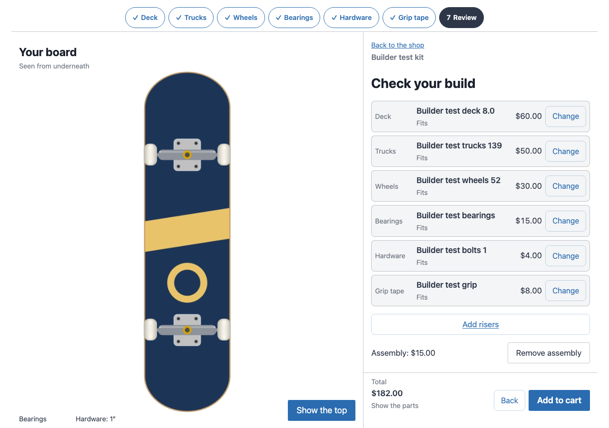
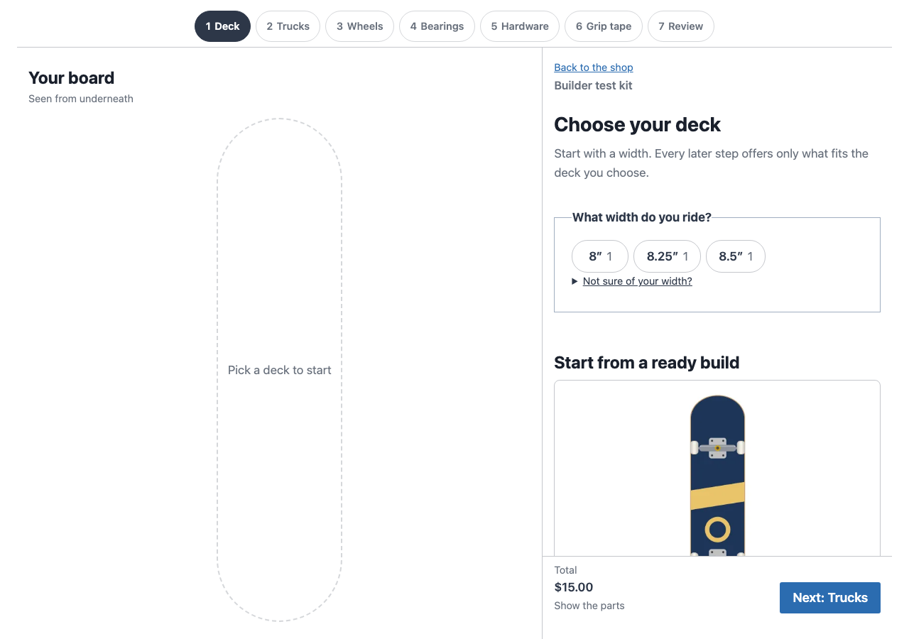
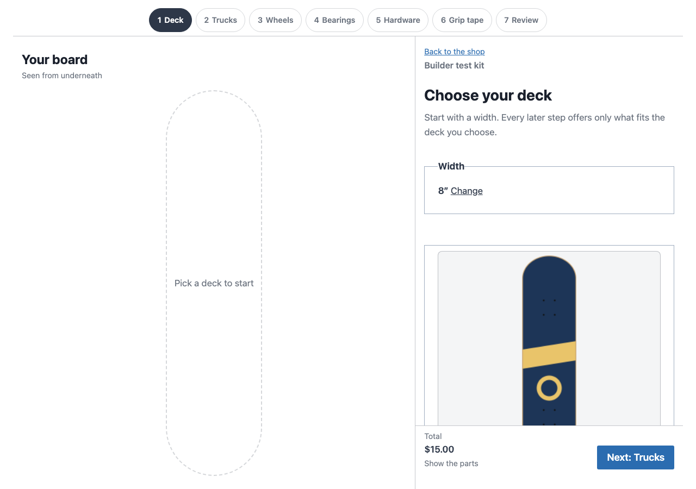
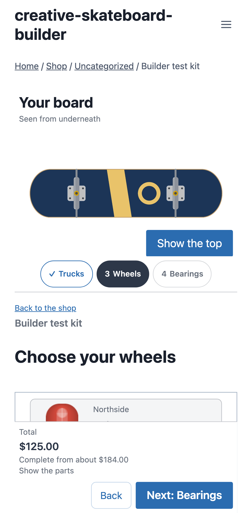

<div align="center">

# Creative Skateboard Builder

A WooCommerce plugin that sells complete skateboards built from the parts a shop already stocks.

[](https://github.com/zachatkinson/creative-skateboard-builder/actions/workflows/ci.yml)
[](CHANGELOG.md)
[](LICENSE)


<picture>
  <source media="(prefers-color-scheme: dark)" srcset="docs/images/review-dark.png">
  
</picture>

</div>

## Contents

- [About](#about)
- [Features](#features)
- [Screenshots](#screenshots)
- [Requirements](#requirements)
- [Installation](#installation)
- [Getting started](#getting-started)
- [Extending it](#extending-it)
- [How it is built](#how-it-is-built)
- [Quality](#quality)
- [Development](#development)
- [Documentation](#documentation)
- [Contributing](#contributing)
- [Security](#security)
- [Licence](#licence)

## About

A shop that sells decks, trucks, wheels, bearings, hardware and grip tape can sell them as a complete board. The shopper goes one step a part, sees only the parts that fit what they have picked, watches the board take shape, and adds the build to the cart. Each part keeps its own cart and order line, so stock, tax, refunds and the shop's reports work as they do for any other product.

It is built by [Creative Branding](https://creativebranding.ca). Skatehouse is the first shop to run it.

## Features

**For the shopper**

- **Only what fits.** Fit is worked out from each part's specs: trucks for the deck's width, wheels that clear the trucks, risers where the wheels need them, and bolts long enough to reach through.
- **The deck's width first,** with a guide by shoe size. Every later step offers only what fits that deck.
- **Long steps stay short.** One card for each look, with search, filters, sort, 30 cards at a time, and sold-out parts folded away.
- **A picture of the build,** drawn to scale from each part's layer image, underneath and on top.
- **The total in view,** with an estimate for the parts still to pick.
- **Ways in.** A deck's own page opens the builder with that deck picked, a rider build can be a starting point, and a build can be shared as a link.
- **Saved builds.** A signed-in customer can save a build and open it again from My account. If a part has changed since, the builder says what changed and offers the closest parts.
- **For everyone.** It works by keyboard and with a screen reader, on a phone, without JavaScript, in English and French (Canada), and right to left.

**For the shop**

- **Each part on its own line** in the cart, on the order and in its emails, with a picture of the build.
- **Specs from where they already are:** a maker's size chart, a field on the product, a mapped attribute, or a CSV import.
- **A catalogue check** that lists the parts the builder can't place, and why.
- **Kits,** a product type with a Build tab: the steps and where their parts come from, the presets, the layout and the assembly fee.
- **For the workshop,** each order's build in a box on the order screen, and an assembly ticket to print.

## Screenshots

| The width question | The decks of that width | A step on a phone |
| --- | --- | --- |
|  |  |  |

More, on desktop and phone, light and dark, in English and French: [docs/reviews/M10/walkthrough](docs/reviews/M10/walkthrough).

## Requirements

| | Version |
| --- | --- |
| WordPress | 7.0 or newer |
| WooCommerce | 11.2 or newer |
| PHP | 8.5 or newer |
| Database | MySQL 8.0 or MariaDB 10.6 or newer |

It is tested on WordPress 7.0 and 7.1 with WooCommerce 11.2 and 11.3, on MySQL 8.4 and MariaDB 10.11, with and without a persistent object cache, with HPOS on, off and syncing, and on multisite. Below any requirement the plugin does nothing and says so on the Plugins screen.

## Installation

1. Make sure WooCommerce 11.2 or newer is active.
2. Download the zip of the newest release from [zachatkinson/creative-releases](https://github.com/zachatkinson/creative-releases/releases).
3. In WordPress, go to **Plugins > Add New > Upload Plugin**, upload the zip and activate it.

WordPress then offers each new version on the Plugins screen, and the plugin checks each zip's SHA-256 before it is installed. To turn update checks off, add `define( 'CBUILD_DISABLE_UPDATES', true );` to `wp-config.php`.

## Getting started

1. **Give your parts their specs.** Each product's **Part specs** panel takes them one part at a time. For a whole catalogue, use a maker's chart under **WooCommerce > Builder > Spec tables**, the CSV under **WooCommerce > Builder > Import and export**, or an attribute mapped under **WooCommerce > Settings > Builder**.
2. **Make a kit.** Add a product of the type **Builder kit**. On its **Build** tab, name the steps and the categories or products each one offers, add any presets, and choose the layout.
3. **Add layer images** to the parts, in the **Layer image** field, so the builder can draw the board. A part without one shows its photo instead.
4. **Check the catalogue** under **WooCommerce > Builder > Catalogue check**, and fix what it lists.
5. **Open the kit's page.** That page is the builder. The **Builder** block puts it on any other page.

The plugin's [readme.txt](readme.txt) answers the common questions: how it sits in a block or classic theme and in a page builder, what it sends off the site, what deleting it removes, and multisite.

## Extending it

Its hooks, REST routes, block attributes, settings keys, order item keys, CSS custom properties and DOM events are listed in [docs/HOOKS.md](docs/HOOKS.md), each with the version it arrived in. From 1.0.0 the public API follows [Semantic Versioning](https://semver.org): no minor or patch release removes or renames any of it, and a deprecation comes first.

For example, a theme can leave "Build a complete with this deck" off its cruiser decks' pages:

```php
add_filter(
	'cbuild_start_button',
	static function ( $button, int $product ) {
		return has_term( 'cruiser', 'product_cat', $product ) ? false : $button;
	},
	10,
	2
);
```

## How it is built

- **One fit engine,** in plain PHP with no WordPress in it (`src/Domain`). Everything else is an edge around it: the shop's products and specs come in through ports, and the page, the state route, the cart and the order go out through adapters. [deptrac](https://github.com/deptrac/deptrac) holds the layers apart.
- **The browser decides nothing.** A pick is an ID the server checks again on every request, and every price is the server's. The page is rendered on the server and updated by a small [Interactivity API](https://developer.wordpress.org/block-editor/reference-guides/interactivity-api/) store, so it works without JavaScript too.
- **WooCommerce's own records.** Products and orders are read and written only through WooCommerce's CRUD, and the plugin's own tables only through prepared queries in its repositories.
- **Nothing leaves the site** but the update check.

[docs/STANDARDS.md](docs/STANDARDS.md) has the layers and the rules the code is written to.

## Quality

Each release is held to twelve dimensions, written down in [docs/AUDIT.md](docs/AUDIT.md), and reviewed against them in [docs/reviews](docs/reviews). CI runs every gate on every pull request.

| Area | Held to |
| --- | --- |
| Unit tests | 100 % of lines and branches in the fit engine |
| Unit and integration tests together | 95 % of all lines |
| Mutation testing | A mutation score of 100 % in the fit engine and 95 % elsewhere ([Infection](https://infection.github.io)), and 90 % in the store ([StrykerJS](https://stryker-mutator.io)) |
| Static analysis | PHPStan level 9, and 10 on the fit engine; PHPCS with WordPress-Extra and WordPress VIP |
| Browsers | Playwright with axe on Chromium, WebKit and Firefox, at phone, tablet and desktop widths, without JavaScript, in French and right to left |
| Accessibility | WCAG 2.2 AA ([docs/A11Y.md](docs/A11Y.md)) |
| Speed | The state route under 80 ms at the 95th percentile with 500 parts in a step; the script under 15 kB and the styles under 10 kB, compressed ([docs/BENCHMARK.md](docs/BENCHMARK.md)) |
| Upgrades | Every published release updated to the new one in CI, with its own data |

## Development

You need PHP 8.5, Composer, Node.js and Docker.

```sh
composer install && npm ci
npm run env:start          # the site at http://localhost:8898, and the integration site at :8899
composer check             # lint, static analysis, layers, grep gates, unit tests and the API check
npm run check              # ESLint, Stylelint, Prettier, TypeScript and Vitest
composer test:integration  # the integration suite, in the integration site
npx playwright test        # the browser suite
```

[CLAUDE.md](CLAUDE.md) lists every command, and [CONTRIBUTING.md](CONTRIBUTING.md) says how a change is made.

## Documentation

| Document | What it covers |
| --- | --- |
| [SPEC.md](docs/SPEC.md), [SPEC-CONFIGURATOR.md](docs/SPEC-CONFIGURATOR.md) | What the plugin does |
| [HOOKS.md](docs/HOOKS.md) | The public API |
| [SETTINGS.md](docs/SETTINGS.md) | Every setting |
| [PRIVACY.md](docs/PRIVACY.md) | Everything it stores, and for how long |
| [SECURITY.md](docs/SECURITY.md) | The OWASP Top 10, walked against the code |
| [DECISIONS.md](docs/DECISIONS.md) | Why it is the way it is |
| [ROADMAP.md](docs/ROADMAP.md), [CHANGELOG.md](CHANGELOG.md) | How it got here, and what changed in each release |

## Contributing

Issues are welcome: a bug, a question or an idea, through the [issue templates](https://github.com/zachatkinson/creative-skateboard-builder/issues/new/choose). Pull requests are by invitation, because every change is held to the audit above; [CONTRIBUTING.md](CONTRIBUTING.md) says how to ask. Everyone taking part follows the [code of conduct](CODE_OF_CONDUCT.md).

## Security

Please report a security problem privately, as [SECURITY.md](SECURITY.md) describes, not in an issue.

## Licence

Copyright (C) 2026 Creative Branding.

Creative Skateboard Builder is free software: you can redistribute it and modify it under the terms of the [GNU General Public License](LICENSE), version 2 or any later version. It is distributed in the hope that it will be useful, but without any warranty.
