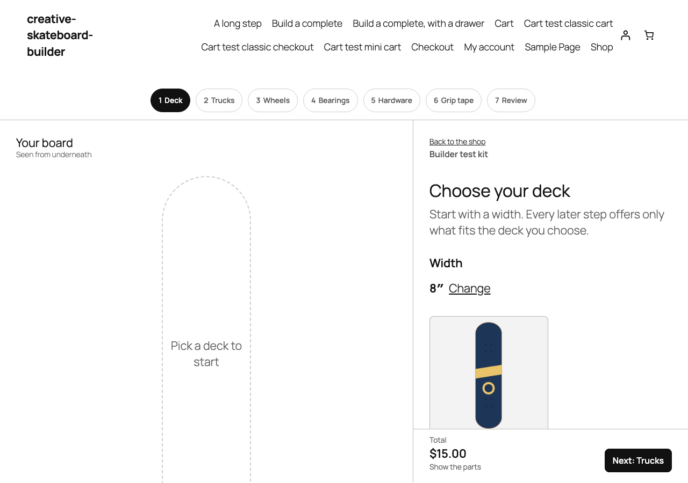
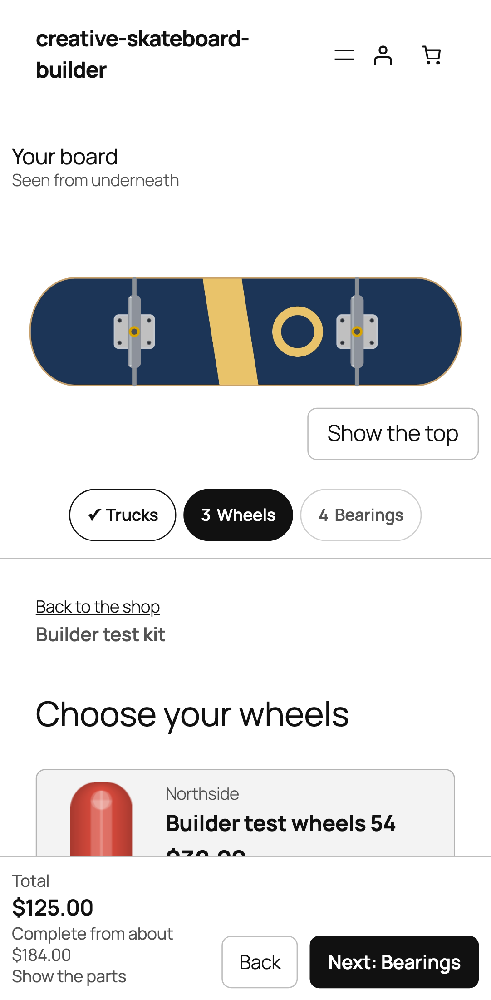
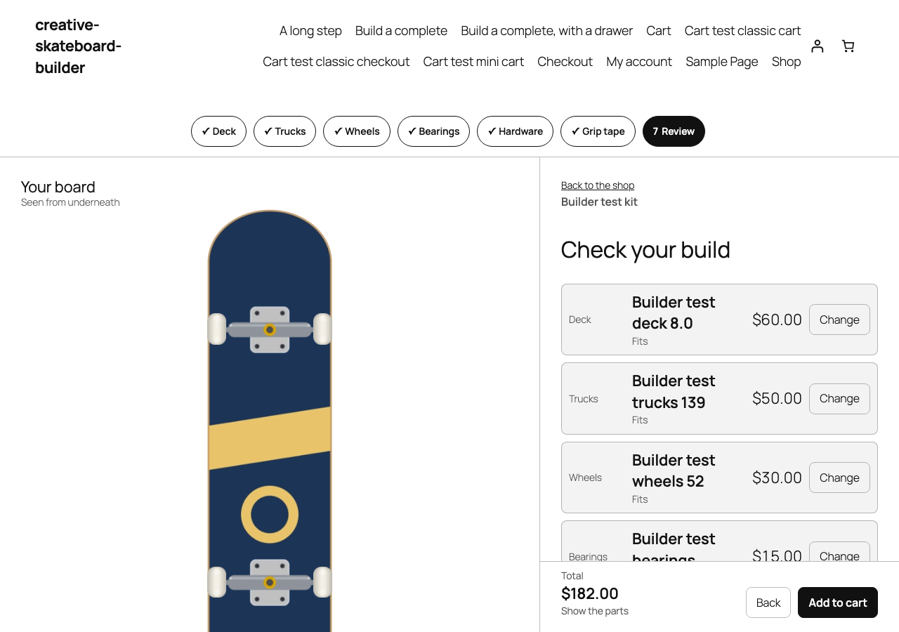

# Creative Skateboard Builder

A WooCommerce plugin that sells complete skateboards built from the parts a shop already stocks. The shopper picks a deck, trucks, wheels, bearings, hardware and grip, and the builder keeps the build honest as they go:

- **It checks fit** from each part's specs: trucks for the deck's width, wheels that clear the trucks, risers where the wheels need them, bolts long enough to reach through.
- **It draws the build**, layer by layer from the parts' own images, and turns it to show the top.
- **It keeps the total in view**, with the estimate for what is still to pick.
- **It gives each part its own line** in the cart and the order, so stock, refunds and the shop's reports work as they always have.

Built by Creative Branding. Skatehouse is the first shop to run it.



| On a phone | The review |
| --- | --- |
|  |  |

## How it is built

The builder is one fit engine in plain PHP, with no WordPress in it, and everything else is an edge around it: the shop's products and specs come in through ports, and the page, the state route, the cart and the order go out through adapters. The browser never decides what fits or what anything costs. Each pick is an ID the server checks again on every request.

The release is held to twelve dimensions, written down in [docs/AUDIT.md](docs/AUDIT.md), and every milestone is reviewed against them in [docs/reviews/](docs/reviews/):

- **Tests:** PHPUnit with 100 % line and branch coverage of the domain and 95 % of everything, mutation testing with Infection (100 % of the domain) and StrykerJS, integration tests in a real WordPress and WooCommerce, and Playwright with axe on Chromium, WebKit and Firefox, at phone, tablet and desktop widths, without JavaScript, in French and right to left.
- **Static analysis:** PHPStan at level 9, and level 10 on the domain; PHPCS with WordPress-Extra and VIP; deptrac for the layers; and grep gates for what a sniff can't see.
- **Budgets:** the state route answers in under 80 ms at the 95th percentile with 2,000 parts, and the builder's script and styles stay under 15 kB and 10 kB compressed.
- **Accessibility:** WCAG 2.2 AA, checked by axe on every state and by the manual script in [docs/A11Y.md](docs/A11Y.md).
- **Upgrades:** every published release is upgraded from in CI, with its own data.

Read more:

- What it does: [docs/SPEC.md](docs/SPEC.md) and [docs/SPEC-CONFIGURATOR.md](docs/SPEC-CONFIGURATOR.md) · How it got here: [docs/ROADMAP.md](docs/ROADMAP.md) and [CHANGELOG.md](CHANGELOG.md)
- Why it is the way it is: [docs/DECISIONS.md](docs/DECISIONS.md)
- For a theme or another plugin: hooks, routes and the public API in [docs/HOOKS.md](docs/HOOKS.md); settings in [docs/SETTINGS.md](docs/SETTINGS.md)
- Security: [docs/SECURITY.md](docs/SECURITY.md) · Privacy: [docs/PRIVACY.md](docs/PRIVACY.md) · Benchmarks: [docs/BENCHMARK.md](docs/BENCHMARK.md)

## Requirements

WordPress 7.0 or newer, WooCommerce 11.2 or newer and PHP 8.5 or newer, on MySQL 8.0 or MariaDB 10.6 or newer, as WordPress itself asks. Tested on MySQL 8.4 and MariaDB 10.11, with and without a persistent object cache, with HPOS on, off and in sync, and on multisite.

## Installing a release

Releases are published to [zachatkinson/creative-releases](https://github.com/zachatkinson/creative-releases) once CI has passed on the tagged commit. Upload the zip under Plugins > Add New > Upload Plugin. From then on WordPress offers each new version on the Plugins screen, and the plugin checks the zip's SHA-256 before WordPress installs it. `readme.txt` has the shop's setup: specs, kits, the layer images and the theme's part.

## Developing

```
composer install && npm ci
composer check && npm run check
npm run env:start
composer test:coverage:all && npm run plugin-check && npx playwright test
```

`npm run env:start` serves the site at http://localhost:8898 and the integration suite's site at http://localhost:8899. [CLAUDE.md](CLAUDE.md) has every command and the rules the code is held to.

## Issues and contributions

Issues are welcome: a bug, a question or an idea, through the templates under [Issues](../../issues/new/choose). Pull requests are by invitation, since every change is held to the audit above; [CONTRIBUTING.md](CONTRIBUTING.md) says how. A security problem goes through [SECURITY.md](SECURITY.md), not an issue.

## Licence

GPL-2.0-or-later. See [LICENSE](LICENSE).
